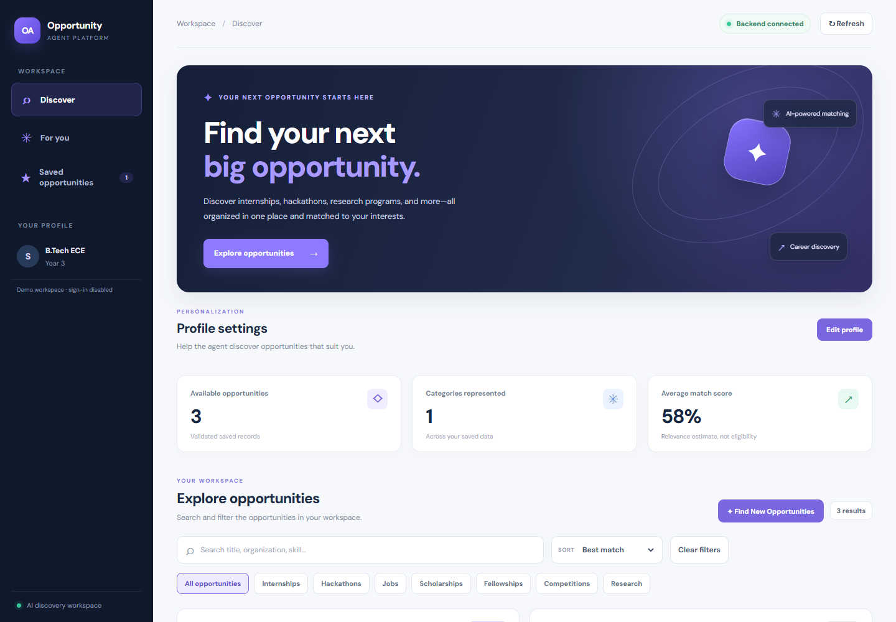
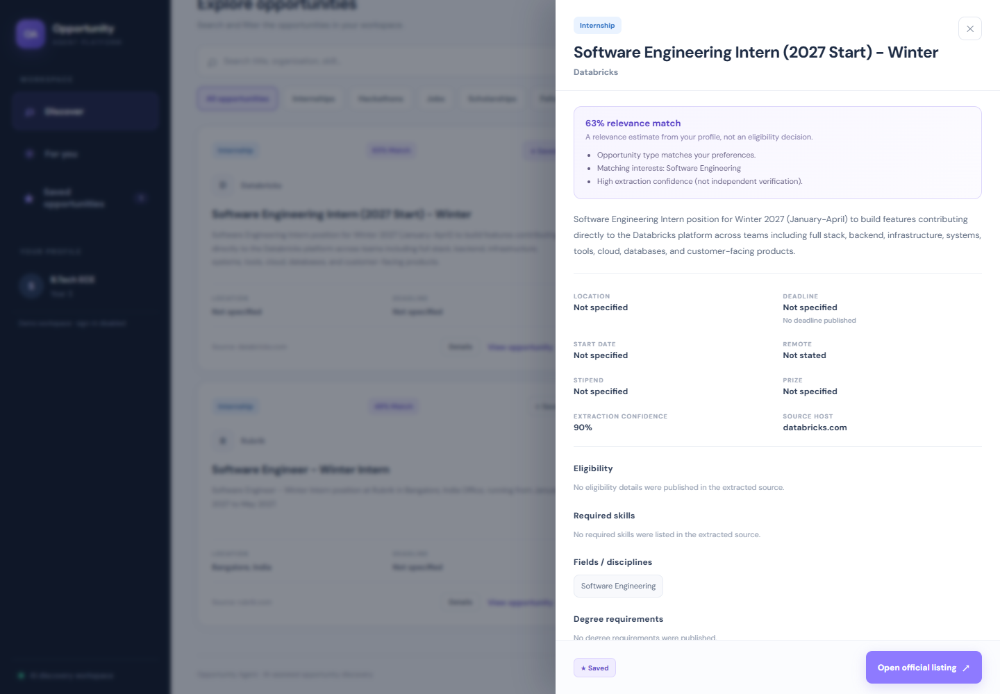

# Opportunity Agent

[](https://github.com/ramrock08-prog/opportunity-agent/actions/workflows/tests.yml)
[](LICENSE)

**An AI-powered opportunity discovery platform for students.**

Repository: <https://github.com/ramrock08-prog/opportunity-agent>  
Live demo: <https://opportunity-agent-v39s.onrender.com>  
CI: [all backend, frontend, and PostgreSQL jobs passing](https://github.com/ramrock08-prog/opportunity-agent/actions)

Opportunity Agent searches the web for internships, hackathons, jobs,
scholarships, fellowships, competitions, and research programs; extracts
structured records with Gemini; validates them; stores them in SQLite
or PostgreSQL; and ranks them against a student profile in a React
dashboard.

This project grew out of the original
[`hackathon-agent`](https://github.com/ramrock08-prog/hackathon-agent)
drone-hackathon scout. The original search, AI filtering, link checking,
email digest, and GitHub Actions ideas are preserved and generalized.



<details>
<summary>Opportunity detail drawer</summary>



</details>

> **Data-quality principle:** this app does not claim an opportunity is
> "verified open". Link checks prove only that a page responded. Deadline,
> eligibility, and open/closed status must be confirmed on the official
> page.

---

## Features

### Discovery and AI
- Tavily web search across seven opportunity categories.
- Gemini structured extraction with strict anti-hallucination rules.
- Verbatim evidence snippets stored with each record.
- Deadlines are only accepted when the source supports them.
- Rule-based validation (URLs, category, confidence, date format, past deadlines).
- URL and title/organization deduplication.
- Optional on-demand link verification with honest status reporting.
- SSRF protection: verification only fetches stored URLs on public hosts.

### Web application
- Responsive React dashboard with dark sidebar.
- Search, category filters, and sorting that work together.
- Personalized "For you" ranking with transparent reasons.
- Save/unsave opportunities with persistent per-user bookmarks.
- Saved opportunities view with a live count.
- Opportunity detail drawer with eligibility, skills, stipend, evidence,
  source/application links, and a manual link check.
- First-run profile onboarding for new accounts.
- Profile editor for degree, branch, year, skills, interests, locations,
  remote preference, and categories.
- Loading, empty, error, and backend-offline states.
- "Explore opportunities" smoothly scrolls to the results workspace.

### Accounts and security
- Optional JWT authentication (`AUTH_REQUIRED=1`).
- PBKDF2-SHA256 password hashing with per-password salt.
- Email verification with single-use, expiring tokens.
- Password reset with session revocation.
- Account lockout after repeated failed sign-ins.
- Revocable server-side sessions (logout works immediately).
- Database-backed rate limits on registration, login, reset,
  verification, discovery, and link checks.
- Strict per-user profiles, bookmarks, and recommendations.
- Demo workspace when authentication is disabled.
- Secrets stay server-side; the frontend never receives API keys.

### Operations
- SQLite for a single instance or PostgreSQL via `DATABASE_URL`.
- Automatic legacy JSON import and schema migrations.
- Transactional writes and a **cross-process** database discovery lock.
- HTML email digest (`notify.py --preview` / `--send`).
- Verification and reset emails through Gmail SMTP.
- GitHub Actions scheduled discovery with JSON snapshot persistence.
- Docker multi-stage build; Render blueprint included.
- 69 SQLite tests + 4 PostgreSQL integration tests, plus two Playwright
  browser flows.

---

## Architecture

```text
                    GitHub Actions (schedule)
                               |
                               v
   Tavily Search  ->  Gemini extraction  ->  validator  ->  deduplicator
                               |                              |
                               |                              v
                     evidence + deadline checks          SQLite
                                                             |
                                                             v
 React dashboard  <----------  FastAPI REST API  <------  services
       |                              |
       |                              +--> JWT auth (optional)
       |                              +--> on-demand link verification
       +--> save / search / filter / detail drawer / profile editor
```

**Backend stack:** Python 3.10+, FastAPI, Pydantic, SQLite/PostgreSQL,
psycopg, google-genai, Tavily, PyJWT, requests.

**Frontend stack:** React 19, Vite 8, JavaScript, CSS, ESLint.

See [`docs/ARCHITECTURE.md`](docs/ARCHITECTURE.md) for request flows,
schema, and trust boundaries.

---

## Quick start (Windows PowerShell)

### 1. Backend

```powershell
cd F:\opportunity-agent

# Activate or create the virtual environment
.\.venv\Scripts\Activate.ps1

# Install dependencies
.\.venv\Scripts\python.exe -m pip install -r requirements.txt

# Create local configuration (never commit .env)
Copy-Item .env.example .env
notepad .env   # add GEMINI_API_KEY and TAVILY_API_KEY

# Run the API
.\.venv\Scripts\python.exe -m uvicorn api:app --reload
```

- API: <http://127.0.0.1:8000>
- Interactive docs: <http://127.0.0.1:8000/docs>
- Health: <http://127.0.0.1:8000/api/health>

### 2. Frontend

In a second terminal:

```powershell
cd F:\opportunity-agent\frontend
& F:\Tools\nodejs\npm.cmd install
& F:\Tools\nodejs\npm.cmd run dev
```

Open <http://localhost:5173>. Vite proxies `/api` to FastAPI, so no CORS
setup is needed for local development.

> On this machine, use `npm.cmd` instead of `npm` because the PowerShell
> script wrapper is blocked by execution policy.

### 3. Production build

```powershell
cd F:\opportunity-agent\frontend
& F:\Tools\nodejs\npm.cmd run build
```

FastAPI serves `frontend/dist` at `/` when `SERVE_FRONTEND=1`:

```powershell
$env:SERVE_FRONTEND = "1"
.\.venv\Scripts\python.exe -m uvicorn api:app --host 0.0.0.0 --port 8000
```

---

## Environment variables

| Variable | Purpose | Default |
|---|---|---|
| `GEMINI_API_KEY` | Gemini extraction | required for discovery |
| `GEMINI_MODEL` | Gemini model ID | `gemini-3.5-flash-lite` |
| `TAVILY_API_KEY` | Web search | required for discovery |
| `OPPORTUNITY_DB_PATH` | SQLite file | `data/opportunity_agent.db` |
| `DATABASE_URL` | PostgreSQL URL; overrides SQLite | empty |
| `CORS_ORIGINS` | Comma-separated allowed origins | localhost:5173 |
| `SERVE_FRONTEND` | Serve React build from FastAPI | `0` |
| `PUBLIC_APP_URL` | Base URL used in account emails | `http://localhost:5173` |
| `AUTH_REQUIRED` | Require sign-in for user data | `0` |
| `AUTH_REQUIRE_VERIFIED` | Require verified email | `1` |
| `AUTH_DEV_SHOW_TOKENS` | Expose dev verification/reset tokens | `0` |
| `AUTH_SECRET` | JWT signing secret | dev fallback |
| `AUTH_TOKEN_MINUTES` | Session lifetime | `10080` (7 days) |
| `RATE_LIMIT_ENABLED` | Database-backed abuse protection | `1` |
| `TRUST_PROXY` | Trust `X-Forwarded-For` behind a proxy | `0` |
| `SENDER_EMAIL` | Account/digest sender | optional |
| `SENDER_PASSWORD` | Gmail app password | optional |
| `RECEIVER_EMAIL` | Digest recipient | optional |

Generate a production secret:

```powershell
.\.venv\Scripts\python.exe -c "import secrets; print(secrets.token_urlsafe(48))"
```

The configured Gemini model was verified against the API key with
`client.models.list()`; no generation credits were used.

### Testing verified accounts without SMTP

For local authentication testing, use a development token flow:

```powershell
$env:AUTH_REQUIRED = "1"
$env:AUTH_REQUIRE_VERIFIED = "1"
$env:AUTH_DEV_SHOW_TOKENS = "1"
$env:AUTH_SECRET = "local-development-secret"
.\.venv\Scripts\python.exe -m uvicorn api:app --reload
```

With SMTP unset, the registration screen shows a **Verify now
(development)** button. Never enable `AUTH_DEV_SHOW_TOKENS` on a public
deployment; configure Gmail SMTP instead.

---

## Discovery commands

```powershell
# One category, three Gemini extractions max
.\.venv\Scripts\python.exe .\run_agent.py --category internship --limit 3

# Revalidate stored records and export a JSON backup
.\.venv\Scripts\python.exe .\clean_saved.py

# Rank current opportunities in the terminal
.\.venv\Scripts\python.exe .\recommend.py

# Preview the email digest without sending
.\.venv\Scripts\python.exe .\notify.py --preview

# Send the digest (requires Gmail variables)
.\.venv\Scripts\python.exe .\notify.py --send
```

`run_agent.py` revalidates existing records before saving, so expired or
malformed rows do not silently accumulate.

---

## API overview

| Method | Endpoint | Auth | Purpose |
|---|---|---|---|
| GET | `/` | – | API info or production React app |
| GET | `/api` | – | API info |
| GET | `/api/health` | – | Status, storage, auth mode |
| GET | `/api/auth/status` | - | Sign-in/verification requirements |
| POST | `/api/auth/register` | - | Create account or start verification |
| POST | `/api/auth/login` | - | Exchange credentials for a session |
| POST | `/api/auth/verify-email` | - | Consume verification token |
| POST | `/api/auth/resend-verification` | - | Resend verification email |
| POST | `/api/auth/forgot-password` | - | Send a reset link |
| POST | `/api/auth/reset-password` | - | Set a new password |
| POST | `/api/auth/logout` | Bearer | Revoke current session |
| GET | `/api/auth/me` | Bearer | Current user |
| GET | `/api/opportunities` | - | Validated opportunities |
| POST | `/api/opportunities/verify` | User | Check stored links on demand |
| GET | `/api/recommendations` | User | Ranked for current profile |
| GET | `/api/profile` | User | Current profile |
| PUT | `/api/profile` | User | Update current profile |
| POST | `/api/discover` | User | Run limited discovery |
| GET | `/api/bookmarks` | User | Current user's bookmarks |
| POST | `/api/bookmarks` | User | Save a bookmark |
| DELETE | `/api/bookmarks?url=...` | User | Remove a bookmark |

"User" means the demo user when `AUTH_REQUIRED=0`, or a valid bearer token
when authentication is enabled.

---

## Testing

```powershell
# Backend unit, database, auth, API, validation, scoring, digest tests
.\.venv\Scripts\python.exe -m pip install -r requirements-dev.txt
.\.venv\Scripts\python.exe -m pytest
```

Current result: **69 passed, 3 skipped** with SQLite (PostgreSQL tests
are skipped unless a database is configured). With the local PostgreSQL
server enabled: **73 passed**.

```powershell
# Starts a temporary PostgreSQL server with pgserver and runs the 3
# PostgreSQL integration tests against it.
.\.venv\Scripts\python.exe .\scripts\test_postgres.py
```

### Browser tests

`scripts/e2e_bookmarks.py` verifies save → refresh → saved-view → remove →
details drawer → mocked link check. Requires:
- FastAPI on `127.0.0.1:8000`
- Vite on `127.0.0.1:5173`
- Microsoft Edge installed (Playwright uses `channel="msedge"`)

```powershell
.\.venv\Scripts\python.exe .\scripts\e2e_bookmarks.py
```

`scripts/e2e_auth.py` verifies registration → required email
verification → profile save → logout → password reset → login →
restored profile. It requires an auth-enabled backend on port `8001`
with `AUTH_REQUIRE_VERIFIED=1` and `AUTH_DEV_SHOW_TOKENS=1`, plus a Vite
server on port `5174` with `VITE_API_BASE=http://127.0.0.1:8001`. See
the script docstring.

Credit-consuming integration probes are deliberately isolated in
`scripts/manual/` so `pytest` never spends Tavily or Gemini credits.

---

## Docker

> Docker is not installed on this development machine, so the image
> recipe has not been executed here. The equivalent production path was
> verified locally by building `frontend/dist` and serving it from
> FastAPI with `SERVE_FRONTEND=1`.

```powershell
# Build the frontend and backend into one image
docker build -t opportunity-agent .

# Run with your local secrets
docker run --rm -p 8000:8000 --env-file .env `
  -e SERVE_FRONTEND=1 -e AUTH_REQUIRED=1 `
  -v opportunity_data:/app/data opportunity-agent
```

Or:

```powershell
docker compose up --build
```

SQLite needs a persistent volume at `/app/data`. The included
`render.yaml` describes a Render deployment; update `CORS_ORIGINS` to
your real URL. Full instructions: [`docs/DEPLOYMENT.md`](docs/DEPLOYMENT.md).

---

## Project structure

```text
opportunity-agent/
├── api.py                  FastAPI app, auth dependencies, routes
├── auth.py                 PBKDF2 hashing + JWT helpers
├── database.py             SQLite schema, migrations, legacy import
├── storage.py              Opportunity repository + JSON export
├── bookmarks.py            Per-user bookmark repository
├── profile.py              Per-user profile model + repository
├── opportunity.py          Opportunity dataclass
├── search.py               Tavily queries and search
├── ai.py                   Gemini extraction prompt + parsing
├── validator.py            Rule-based data validation
├── dedup.py                URL/title deduplication
├── verification.py         Honest on-demand link checks (SSRF-aware)
├── scorer.py               Transparent 0–100 relevance score
├── text_utils.py           Whitespace/encoding hygiene
├── run_agent.py            Discovery pipeline CLI
├── notify.py               HTML email digest
├── agent.py                Legacy original drone scout (kept for history)
├── tests/                  69 SQLite tests + 4 PostgreSQL tests
├── scripts/
│   ├── e2e_bookmarks.py    Playwright bookmark/details flow
│   ├── e2e_auth.py         Playwright auth flow
│   └── manual/             Credit-consuming integration probes
├── frontend/
│   ├── src/App.jsx          Dashboard shell and data loading
│   ├── src/AuthScreen.jsx   Sign-in / registration
│   ├── src/OpportunityCard.jsx
│   ├── src/OpportunityDetail.jsx
│   ├── src/ProfileEditor.jsx
│   └── vite.config.js       Dev proxy to FastAPI
├── docs/
├── Dockerfile
├── docker-compose.yml
├── render.yaml
├── requirements.txt
└── requirements-dev.txt
```

`data/opportunity_agent.db` is created at runtime and ignored by Git.
`bookmarks.json` and `profile.json` are legacy/private local files and are
also ignored.

---

## Data model

`Opportunity` fields: title, type, organization, description, source and
application URLs, deadline, start date, location, remote flag, eligibility,
required skills, fields, degree/year requirements, stipend, prize money,
source host, confidence, verbatim evidence, and deadline evidence.

Relevance scoring is deliberately transparent:

| Component | Maximum points |
|---|---|
| Selected opportunity type | 20 |
| Interest matches | 35 |
| Skill matches | 20 |
| Location match | 15 |
| Remote preference | 10 |
| Extraction confidence | 10 |

The final score is normalized to 0–100. It is a **relevance estimate**,
not an eligibility decision.

---

## Security notes

Implemented:
- `.env`, local profile, bookmarks, and database files are gitignored.
- Password hashing uses PBKDF2-SHA256 with random salts.
- JWT sessions are signed, expiring, and revocable server-side.
- Email verification and password reset use single-use, expiring,
  hashed tokens.
- Failed sign-ins trigger a 15-minute account lockout.
- Database-backed rate limits cover registration, login, verification,
  password reset, discovery, and link checks.
- Per-user queries prevent cross-account profile/bookmark access.
- API keys never reach the browser; auth tokens are sent as headers.
- CORS uses an explicit allow-list.
- Link verification rejects private/loopback hosts and re-checks every
  redirect to reduce SSRF risk.
- Frontend HTML escapes untrusted opportunity text via React; email HTML
  is explicitly escaped.
- PostgreSQL is supported through the same tested repository layer.

Remaining limitations:
- No MFA/WebAuthn and no admin console.
- Fixed-window rate limiting is database-backed but not a distributed
  Redis limiter; it is adequate for this project's scale.
- Gmail SMTP deliverability depends on the account's app-password setup.
- No account email-change flow or data-export/delete workflow.
- SQLite still serializes writes; use PostgreSQL for higher concurrency.
- Docker has not been built on this Windows machine (Docker absent).
- A public deployment still requires your Render account and secrets.

These are documented intentionally rather than hidden.

---

## Live deployment

- **URL:** <https://opportunity-agent-v39s.onrender.com>
- **Host:** Render Docker web service (free instance)
- **Database:** Render PostgreSQL (free instance, Oregon)
- **CI:** GitHub Actions (backend tests, frontend lint/build, PostgreSQL tests)

The public demo intentionally runs with `AUTH_REQUIRE_VERIFIED=0` so
visitors can create an account without needing an SMTP mailbox. Email
verification is fully implemented and tested; to enforce it, add
`SENDER_EMAIL` and `SENDER_PASSWORD` (Gmail app password) in Render,
set `AUTH_REQUIRE_VERIFIED=1`, and redeploy. Do not enable
`AUTH_DEV_SHOW_TOKENS` publicly.

The free Render web instance sleeps after inactivity; the first request
may take several seconds. The free PostgreSQL instance is managed by
Render and may have its own retention policy.

---

## Roadmap status

- **Phase A — Core frontend:** complete (details, saved count, filters,
  sorting, profile, search, states).
- **Phase B - Backend architecture:** SQLite and PostgreSQL supported;
  JSON storage replaced with automatic migrations.
- **Phase C — AI quality:** evidence snippets, deadline-evidence rules,
  on-demand link verification, deduplication, confidence scoring.
- **Phase D — Original functionality:** email digest and scheduled GitHub
  Actions restored on the generalized pipeline.
- **Phase E - Accounts:** JWT auth, verification, reset, lockout,
  revocable sessions, rate limits, and per-user isolation.
- **Phase F - Deployment:** deployed on Render with PostgreSQL, Docker
  packaging, CI, and documentation. Email verification is one environment
  variable away once SMTP credentials are added.
- **Phase G — Interview readiness:** see
  [`docs/INTERVIEW.md`](docs/INTERVIEW.md) for a demo script, likely
  questions, and a code tour.

---

## Honest limitations

- Search snippets can be incomplete; extraction may miss facts.
- A reachable URL does not prove a role is open.
- Eligibility and deadlines are only as reliable as the source snippet.
- Discovery quality depends on Tavily ranking and Gemini extraction.
- The app intentionally keeps records with unknown deadlines rather than
  inventing one (validation rejects only dates that are malformed or past).
- Existing stored records may contain older encoding artifacts; new
  records are cleaned automatically.

Always verify on the official page before applying.

---

## License

MIT. See [`LICENSE`](LICENSE). The original drone-scout project is also
MIT-licensed; the legacy `agent.py` is retained for history rather than
used by the web application.
